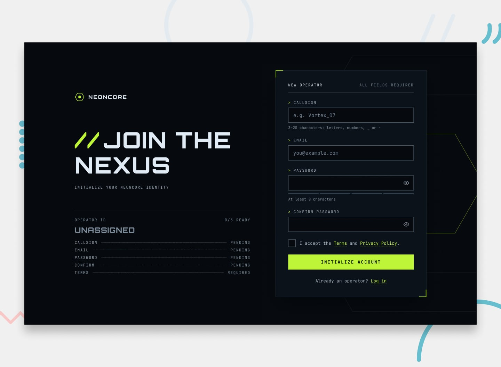

# Frontend Mentor - Gamer sign-up form (NEONCORE)



Solução do desafio **Gamer sign-up form** (nível junior) do [Frontend Mentor](https://www.frontendmentor.io). Este desafio é prática de front end **com retorno dos dados pelo back end**: o objetivo foi entender o mecanismo de envio de formulário e a renderização no servidor. O enunciado original está no fim deste arquivo.

- **Site publicado:** _(preencher depois do deploy no Render)_
- **Repositório:** este é um monorepo de desafios; esta solução vive em `junior/gamer-sign-up-form-main`.

## Como funciona

Node + Express 5 + EJS, renderização no servidor (SSR/MPA) e envio nativo de formulário (`<form method="POST">`), sem `fetch`/AJAX.

| Requisição | Resposta |
|---|---|
| `GET /` | Formulário (EJS) |
| `POST /` com dados válidos | `303` para `GET /sucesso?callsign=...` (Post/Redirect/Get: recarregar não reenvia o formulário) |
| `POST /` com dados inválidos, mas com a forma do formulário | `422` e o formulário renderizado no próprio POST, com valores preservados (a senha **nunca** volta), mensagens, força da senha e readout calculados no servidor |
| `POST /` com corpo que o formulário não produz (campo ausente, repetido, JSON) | `400` e a tela de erro `views/erro.ejs` |
| `GET /sucesso?callsign=...` | Tela de sucesso, só se o callsign passar na mesma regra do formulário; senão volta para `/` |

- **O servidor é a autoridade.** `validarFormulario(dados)` (`validacao.js`) é uma função pura que devolve `{ ok, erros, valores }`; `readout.js` calcula a força da senha e o readout. Tudo que vem do usuário é escapado no EJS (`<%= %>`).
- **Sem JavaScript tudo funciona** (foco no primeiro campo inválido e no título do sucesso via `autofocus`, mensagens, readout, força).
- **O JS (ES6+) só espelha a UX**, nunca envia nem bloqueia o formulário: validação ao sair do campo e a cada tecla depois de checado, medidor de força, mostrar/ocultar senha, readout "N/5 ready" e "Transmitting_" no botão. As regras do cliente (`public/js/regras.js`, `forca.js`) são um espelho das do servidor: **mudou uma, mude a outra**.
- **Estilos:** Sass (`scss/`) compilado para `public/style.css` (versionado; nunca editar o `.css`), BEM, mobile-first, tokens como custom properties.

```
server.js, validacao.js, readout.js   # rotas, regras e cálculos do servidor
views/                                # index, sucesso e erro (+ partials)
scss/                                 # fonte dos estilos (main.scss só com @use)
public/                               # style.css, js/ (UI), assets/ (fontes e imagens)
tests/, playwright.config.js          # Playwright + Chromium + axe-core
design/                               # imagens do design (referência)
```

## Como rodar

Requer Node 18 ou superior.

```bash
npm install
npm run build   # compila o Sass para public/style.css
npm start       # http://localhost:3000 (usa a porta de PORT, se definida)
npm run dev     # igual, reiniciando ao salvar (node --watch)
npm run watch   # Sass em modo watch (rode em outro terminal)
```

## Testes

Playwright + Chromium + axe-core, nos três tamanhos do design (desktop 1440, tablet 768, mobile 375). O servidor de teste sobe sozinho na porta 3100.

```bash
npx playwright install chromium   # só na primeira vez
npm test
```

| Arquivo | O que cobre |
|---|---|
| `fluxo.spec.js` | fluxo feliz, erro de validação, UI em tempo real, "Transmitting_" |
| `servidor.spec.js` | sem JavaScript, POST direto (400/422/303), escape de HTML, `/sucesso` |
| `interacao.spec.js` | medidor, ticks, erro dos termos, senha visível, campos somente leitura ao enviar |
| `acessibilidade.spec.js` | axe-core (WCAG 2.2 A/AA e boas práticas) em todas as telas |
| `teclado.spec.js` | teclado, foco visível, nomes e descrições, landmarks, contraste real, movimento reduzido, reflow |

## Deploy no Render

O repositório tem vários projetos e **só este vai para o Render**. Web Service com:

| Campo | Valor |
|---|---|
| Branch | `gamer-sign-up` |
| **Root Directory** | `junior/gamer-sign-up-form-main` |
| Build Command | `npm install` |
| Start Command | `npm start` |
| Variável (opcional) | `NODE_VERSION` = `22` |
| Build Filters → Included Paths | `junior/gamer-sign-up-form-main/**` (não redeploya com mudanças nos outros desafios) |

O servidor escuta em `process.env.PORT` e em `0.0.0.0`. O `public/style.css` já está versionado, então o deploy não precisa rodar o Sass. No plano gratuito o serviço "dorme" depois de um tempo sem acesso e a primeira requisição seguinte demora mais.

## Diferenças em relação ao enunciado

Decisões e pontos em aberto, para ficar registrado:

- A validação em tempo real também roda ao sair de um campo **vazio** e o erro dos termos aparece ao desmarcar o checkbox (o enunciado prevê isso só no envio). O envio, porém, nunca é bloqueado pelo JS: o servidor valida tudo.
- Não há espera artificial antes do sucesso: o envio é um POST real e o servidor responde.
- Ao enviar, as senhas reveladas **não** voltam a ficar ocultas antes do POST (pendente).
- `Terms`, `Privacy Policy` e `Log in` têm `href="#"`: o desafio não tem essas páginas.

## Acessibilidade

`label`/`for`, `aria-invalid` e `aria-describedby` (dica ou erro), regiões `aria-live` (erros e força da senha), foco no primeiro campo inválido e no título do sucesso e do erro, foco visível em tudo, landmarks e um `h1` por tela, texto com contraste AA, `prefers-reduced-motion`, reflow em 320px também com texto a 200%. A verificação é automatizada (axe-core e testes de teclado e de árvore de acessibilidade); falta um teste manual com leitor de tela real.

---

## Enunciado do desafio (Frontend Mentor)


## Welcome! 👋

Thanks for checking out this coding challenge.

[Frontend Mentor](https://www.frontendmentor.io) challenges help you improve your coding skills by building realistic projects.

**To do this challenge, you need a basic understanding of HTML, CSS and JavaScript.**

## The challenge

Build a sign-up form for NEONCORE, a competitive-gaming network, and get it looking as close to the design as possible.

Most of the work is in the form's states. Every field validates, the password field has a strength meter and a show/hide button, and the submit button has loading and success states. Building all of that so it works for keyboard and screen reader users is the real practice here.

You can use any tools you like to help you complete the challenge. So if you've got something you'd like to practice, feel free to give it a go.

Your users should be able to:

- Fill in the form with a callsign, email, password, and password confirmation, and accept the terms
- Receive form validation messages if:
  - Any field is missed
  - The callsign is shorter than 3 characters, longer than 20, or uses anything other than letters, numbers, `_` or `-`
  - The email address is not formatted correctly
  - The password is shorter than 8 characters
  - The passwords don't match
  - The terms checkbox isn't ticked
- Show and hide each password with the eye button
- See a password strength meter update as they type
- See a loading state on the button while the form submits, then a success message
- Complete the form only using their keyboard
- Have inputs, hints, error messages, and the success message announced on their screen reader
- View the optimal layout for the interface depending on their device's screen size
- See hover and focus states for all interactive elements on the page

The Operator ID readout beside the form on desktop is an optional extra. It mirrors what's happening in the form, so you can build it once the form itself works.

## How the form behaves

The designs show each state, but a still image can't show when one state turns into the next. Here's how the form should behave.

### When fields are checked

- A field is checked when it loses focus with something in it. Leaving a field that was never filled shows nothing.
- Once a field has been checked, it re-checks on every keystroke. An error clears as soon as it's fixed, and the check icon appears as soon as the value is valid.
- Before a field has been checked, its empty-field message only appears on submit.
- Trim the callsign before checking it, so a callsign of only spaces counts as empty.
- Typing in the password re-checks the confirm field, if that has already been checked.
- The terms error only appears on submit, and clears as soon as the checkbox changes.

### Password strength

- The meter updates from the first character as the user types. An empty field shows no segments and no label.
- A password under 8 characters is always Weak.
- From 8 characters, score one point each for: 8 or more characters, 12 or more characters, both uppercase and lowercase letters, a number, and a symbol. Cap the score at 4: 1 is Weak, 2 is Fair, 3 is Good, and 4 is Strong.
- For example, `neoncore` is Weak, `neoncore99` is Fair, `Neoncore99` is Good, and `Tr4nsm1t!Nexus` is Strong.
- Strength is advice only. The one password rule is 8 or more characters.

### Submitting

- On an invalid submit, check every field, move focus to the first invalid one, and announce how many fields need attention, for example "3 fields need attention".
- On a valid submit, hide any revealed passwords, lock the fields, and show `Transmitting_` on the button. There's no server for this challenge, so wait a moment before showing the success message.
- On success, the success message replaces the form in the same panel, and focus moves to the success heading.

